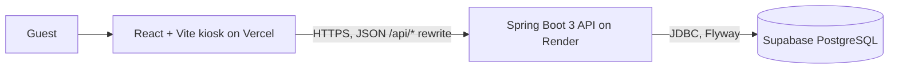
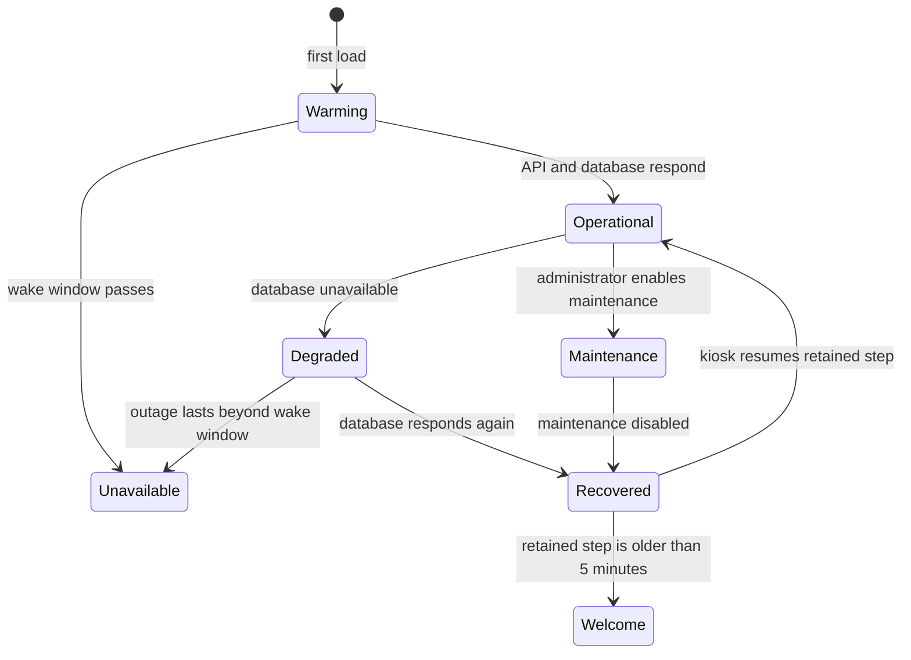
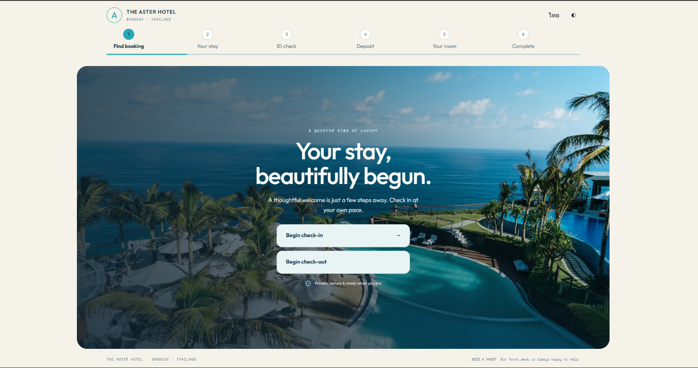

# Hotel Self Check-In Kiosk

[](https://github.com/AivaN-Bash/Hotel_Checkin/actions/workflows/ci.yml)

A portfolio demo for a bilingual, touch-friendly hotel self-service kiosk. Guests can check in, receive an assigned room and demo QR key, or check out an active stay. React/Vite serves the kiosk, Spring Boot coordinates booking and room state, and Supabase PostgreSQL stores bookings, room assignments, and check-in/check-out timestamps. **Live demo:** [Open the kiosk](https://frontend-nine-kohl-nzqk24mi4s.vercel.app).

> This is a demonstration, not hotel operating software. Identity verification, payment, and the QR key are simulations. Use only the included fake records.

## Architecture



The browser keeps the active journey in a reducer, not persistent storage. The backend exposes DTOs, validates input, and owns booking and room state. Check-in assigns an available matching room in a transaction. Check-out records its timestamp, changes the booking to `CHECKED_OUT`, and releases its room in a transaction. See the [architecture and data model](docs/architecture.md) and [API reference](docs/api.md).

## Stack

| Part | Choice | Why |
| --- | --- | --- |
| Kiosk | React, Vite, TypeScript strict mode | Small static build, typed screens, fast local feedback |
| UI | HeroUI v3, Tailwind CSS 4, `tailwind-variants` | Accessible React Aria components with theme tokens and small reusable wrappers |
| API | Java 17, Spring Boot 3, Spring Web, Validation, Data JPA, Actuator | Familiar layered REST service, validation, and health support |
| Database | H2 `dev`; PostgreSQL in `prod` | Easy local startup and a production SQL database |
| Schema | Flyway | Versioned schema and fake seed data; Hibernate validates rather than changes schema |
| Typography | Locally bundled Outfit Variable and Space Mono | Clear headings and body copy, with monospace reserved for short metadata |
| Hosting | Vercel + Render + Supabase | Static frontend, one small API container, hosted Postgres for a personal demo |
| Quality | Vitest, Testing Library, MockMvc/JUnit, ESLint, Prettier, Spotless, GitHub Actions | Repeatable behavior, formatting, and build checks |

The UI follows the current [HeroUI v3 quick start](https://heroui.com/en/docs/react/getting-started/quick-start): React 19, Tailwind CSS 4, and the `@heroui/styles` CSS import. Styling and variants use v3 APIs; no HeroUI v2 provider or component APIs are used.

## UI/UX principles in this kiosk

1. **Semantic intent:** each step has one primary continue action, with navigation and restart as secondary/tertiary actions.
2. **Accessibility:** HeroUI React Aria controls, labeled inputs, visible focus, high contrast, keyboard support, and large touch targets.
3. **Composition:** screens combine shared layout, progress, card, and button components.
4. **Progressive disclosure:** booking details, review, simulated ID, deposit, room, and completion each have their own step.
5. **Predictability:** shared large kiosk controls, progress, loading, validation, error, and idle warning patterns.
6. **Type safety:** strict TypeScript types cover flow state, API responses, and component callbacks.
7. **Separation:** reducer and hooks own flow, idle timing, and service polling; components present that state.
8. **Developer experience:** `/dev/components` previews shared controls and the maintenance screen.
9. **Typography and theming:** Outfit is used consistently for headings and body copy; Space Mono is limited to short labels and metadata. Hotel colors, spacing, radius, light/dark mode, and reduced-motion rules live in `frontend/src/theme/hotel.css`.
10. **Extensibility:** `KioskButton` and `StepCard` extend HeroUI v3 variants with `tailwind-variants`.

## Project structure

| Path | Responsibility |
| --- | --- |
| `frontend/src/App.tsx` | Connects kiosk state, service status, and journey screens |
| `frontend/src/hooks/useKioskFlow.ts` | Owns the check-in/check-out reducer and transitions |
| `frontend/src/pages/FlowScreens.tsx` | Renders welcome, lookup, review, and completion screens |
| `frontend/src/api/` | Sends typed requests through the shared API client |
| `frontend/src/i18n/` | English and Thai kiosk copy |
| `backend/.../api/` | HTTP routes, request validation, and safe errors |
| `backend/.../service/` | Booking, room, check-in, checkout, and status logic |
| `backend/.../repository/` | Database queries and transaction locks |
| `backend/src/main/resources/db/migration/` | Versioned PostgreSQL schema and demo fixtures |
| `frontend/src/**/*.test.tsx`, `backend/src/test/` | UI, API, and service verification |

Keep changes in the layer that owns the behavior: screens present state, services enforce business rules, repositories perform database access, and Flyway migrations evolve persistent data.

## Kiosk flow

| Screen | Primary action | Secondary action | Tertiary action |
| --- | --- | --- | --- |
| Welcome | Begin check-in / Begin check-out | Change language / theme | — |
| Find booking | Find booking | Change lookup method / Back | Start over |
| Review stay | Details look right | Back | Start over |
| Identity demo | Confirm identity | Back | Start over |
| Deposit demo | Confirm demo deposit | Back | Start over |
| Room assigned | Continue | — | Start over |
| Success | Return to welcome | — | — |
| Maintenance | Try again | Change language | — |

Choose **Begin check-in** for a confirmed booking or **Begin check-out** for a guest who is already checked in. Check-out skips the identity and deposit demo steps, asks the guest to confirm, then releases the assigned room. Its progress indicator shows the three checkout steps; check-in shows six steps. The completion screen is a separate, centered confirmation card without the journey progress bar, and offers a clear return-to-welcome action. It resets after 12 seconds; inactivity resets other guest sessions at 60 seconds, while maintenance pauses that timer.

The demo bookings are persistent database records: `DEMO2026` and `DEMO2027` start confirmed for check-in, while `DEMO2028` starts checked in for checkout. The backend recycles completed demo stays on the next matching lookup: check-in lookup restores `DEMO2026`/`DEMO2027`, and checkout lookup re-arms `DEMO2028` in an available room. This behavior applies only to these exact seeded demo codes; real guest bookings and completed stay records remain unchanged. The local development database is also reseeded when the backend restarts.

## Resilience and maintenance mode



`GET /api/v1/status` checks the database with two-second connection, query, and PostgreSQL socket timeouts and returns HTTP 200 with `OPERATIONAL`, `DEGRADED`, or `MAINTENANCE` details. `/api/v1/health` is a lightweight liveness endpoint. Database failures on normal API calls return a safe HTTP 503 error. The frontend polls every 15 seconds with a five-second request timeout and exponential retry; initial unreachable status gets up to a 60-second wake-up screen before it becomes the maintenance screen. An explicit backend maintenance state shows maintenance immediately. When service recovers, the kiosk resumes the same step for five minutes, then resets to Welcome.

Set `ADMIN_API_KEY` to a secret of at least 32 characters on the backend. The key is checked in constant time and is never returned or logged. The runtime state is held in memory and can be toggled while the database is down. Start maintenance:

```sh
curl -X POST "$API_URL/api/v1/admin/maintenance" \
  -H "Content-Type: application/json" \
  -H "X-Admin-Key: $ADMIN_API_KEY" \
  -d '{"enabled":true,"message":"We are preparing your room.","estimatedBackAt":"2030-01-01T12:00:00Z"}'
```

Send the same request with `"enabled":false` to recover. Set `MAINTENANCE_MODE=true` to boot into maintenance after a restart. `/status`, `/health`, and `/admin/maintenance` remain available while maintenance is enabled.

## Screenshots




Run `npm run dev` in `frontend`, then open `/dev/components` to preview reusable controls and maintenance. The local API seeds `DEMO2026` and `DEMO2027` for check-in and `DEMO2028` as an active checked-in stay for checkout. Restarting the local backend recreates this in-memory demo state; restarting the hosted API does not reset its PostgreSQL database.

## Local setup

Requirements: Java 17+, Maven 3.9+, Node.js 22+.

```sh
cd backend && mvn spring-boot:run
```

In a second terminal:

```sh
cd frontend
npm ci
npm run dev
```

Open the Vite URL (normally `http://localhost:5173`). The backend defaults to the H2 `dev` profile and seeds fake bookings and rooms. Use `DEMO2026` or `DEMO2027` for check-in and `DEMO2028` for checkout. Frontend `VITE_API_URL` defaults to `/api`; local Vite proxies `/api` to `http://localhost:8080`.

Configuration templates are in [backend/.env.example](backend/.env.example) and [frontend/.env.example](frontend/.env.example). The default local profile does not require Postgres. Never use these fake records as real guest data.

## API

All endpoints are versioned under `/api/v1`. Request and response examples are in [docs/api.md](docs/api.md), and OpenAPI UI is at `/swagger-ui` when the backend runs.

| Method | Endpoint | Purpose |
| --- | --- | --- |
| POST | `/bookings/lookup` | Find by booking code, or last name and phone |
| POST | `/bookings/checkout-lookup` | Find an active checked-in stay |
| POST | `/checkins` | Transactional room assignment; requires `Idempotency-Key` |
| POST | `/checkouts` | Record checkout and make the room available |
| GET | `/checkins/{id}` | Read a completed check-in |
| GET | `/rooms` | Admin room status; requires `X-Admin-Key` |
| GET | `/status` | Public API/database/maintenance status |
| GET | `/health` | Public liveness |
| POST | `/admin/maintenance` | Protected in-memory maintenance toggle |

Errors use `{ "timestamp", "status", "code", "message" }`. Entities are not serialized directly.

## Current deployment

The live demo uses Vercel for the frontend, Render for the Spring Boot API, and Supabase PostgreSQL for persistence. Render runs the `backend/` Docker service from `main`; Vercel builds the `frontend/` Vite app from `main`. The rewrite in `frontend/vercel.json` sends `/api/*` requests to Render. Flyway applies schema and demo-data migrations when the API starts. After pushing changes, verify that Render has deployed the same commit; if it has not, use **Manual Deploy → Deploy latest commit**. A healthy `/status` response confirms connectivity but does not confirm which application commit is running.

Render requires `SPRING_PROFILES_ACTIVE=prod`, `DATABASE_URL`, `DATABASE_USERNAME`, `DATABASE_PASSWORD`, `ADMIN_API_KEY`, and `MAINTENANCE_MODE`. `CORS_ALLOWED_ORIGINS` defaults to the live Vercel origin plus local Vite; set it to a comma-separated exact-origin allowlist when using another domain. Never commit credentials. Check `https://hotel-checkin-1iql.onrender.com/api/v1/status` and the Vercel `/api/v1/status` route; both should report API and database `UP`.

For a demo, use `DEMO2026` or `DEMO2027` to check in and `DEMO2028` to check out. Reusable demo behavior requires the current backend code (commit `2145d29` or later). After checkout, the booking is `CHECKED_OUT`, `checkins.checked_out_at` is populated, and its room is `AVAILABLE` until the next matching demo lookup re-arms it.

## Security and known limits

- Fake seed data only; no guest documents or payment details are collected.
- The room QR is a demo identifier, not a door lock credential.
- Admin key is server-only, must be at least 32 characters, compared in constant time, and never logged. `GET /rooms` is also protected.
- Supabase's shared-pooler password and API admin key must be stored as provider secrets, never committed.
- Free hosts sleep or pause; expect delayed first requests. Supabase Free has no automatic database backups, so it is for disposable demo data only.
- The API is intended for a portfolio demo and lacks production guest authentication, rate limiting, audit trails, alerting, backups, and real payment/identity integrations.
- The browser-side flow is not a substitute for a hotel property-management system or front-desk review.

## Tests and quality checks

```sh
cd frontend
npm ci
npm test
npm run lint
npm run format:check
npm run build
```

```sh
cd backend
mvn verify
```

The GitHub Actions workflow runs frontend checks and backend Maven verification on pushes and pull requests to `main`.

## What I'd improve next

- Replace demo verification and deposit steps with a property-management integration and a compliant payment provider.
- Add authenticated guest sessions, rate limiting, structured monitoring, alerting, and managed backups before real use.
- Add end-to-end browser coverage for touch layouts, screen readers, and failure/recovery behavior against a deployed preview.
- Add room assignment policies, occupancy management, and audited administrative operations.
