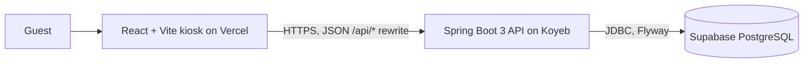
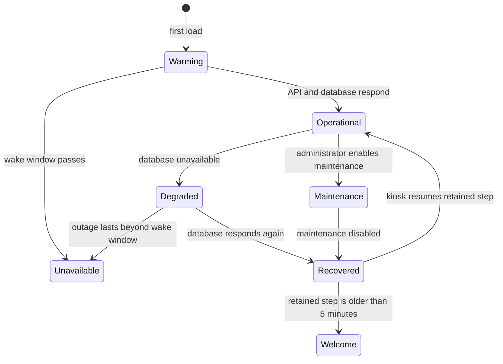

# Hotel Self Check-In Kiosk

[](https://github.com/AivaN-Bash/Hotel_Checkin/actions/workflows/ci.yml)

A portfolio demo for a bilingual, touch-friendly hotel self check-in kiosk. Guests can find a seeded reservation, review their stay, step through simulated identity and deposit checks, and receive an assigned room with a demo QR key. React/Vite serves the kiosk, Spring Boot validates and coordinates check-ins, and PostgreSQL stores bookings, rooms, and check-in records. **Live demo:** [Open the kiosk](https://frontend-nine-kohl-nzqk24mi4s.vercel.app).

> This is a demonstration, not hotel operating software. Identity verification, payment, and the QR key are simulations. Use only the included fake records.

## Architecture



The browser keeps the active journey in a reducer, not persistent storage. The backend exposes DTOs, validates input, and owns booking and room state. A check-in transaction locks its booking and selects an available matching room with `FOR UPDATE SKIP LOCKED`; the idempotency key makes retries safe. See the [architecture and data model](docs/architecture.md) and [API reference](docs/api.md).

## Stack

| Part | Choice | Why |
| --- | --- | --- |
| Kiosk | React, Vite, TypeScript strict mode | Small static build, typed screens, fast local feedback |
| UI | HeroUI v3, Tailwind CSS 4, `tailwind-variants` | Accessible React Aria components with theme tokens and small reusable wrappers |
| API | Java 17, Spring Boot 3, Spring Web, Validation, Data JPA, Actuator | Familiar layered REST service, validation, and health support |
| Database | H2 `dev`; PostgreSQL in `prod` | Easy local startup and a production SQL database |
| Schema | Flyway | Versioned schema and fake seed data; Hibernate validates rather than changes schema |
| Hosting | Vercel Hobby + Koyeb Free + Supabase Free | Static frontend, one small API container, hosted Postgres for a personal demo |
| Quality | Vitest, Testing Library, MockMvc/JUnit, ESLint, Prettier, Spotless, GitHub Actions | Repeatable behavior, formatting, and build checks |

The UI follows the current [HeroUI v3 quick start](https://heroui.com/en/docs/react/getting-started/quick-start): React 19, Tailwind CSS 4, and the `@heroui/styles` CSS import. Styling and variants use v3 APIs; no HeroUI v2 provider or component APIs are used.

## UI/UX principles in this kiosk

1. **Semantic intent:** each step has one primary continue action, with navigation and restart as secondary/tertiary actions.
2. **Accessibility:** HeroUI React Aria controls, labeled inputs, visible focus, high contrast, keyboard support, and large touch targets.
3. **Composition:** screens combine shared layout, progress, card, and button components.
4. **Progressive disclosure:** booking details, review, simulated ID, deposit, room, and completion each have their own step.
5. **Predictability:** shared large kiosk controls, progress, loading, validation, error, and idle warning patterns.
6. **Type safety:** strict TypeScript types cover flow state, API responses, and component callbacks.
7. **Separation:** reducer and hooks own flow, idle timing, and service polling; components present that state.
8. **Developer experience:** `/dev/components` previews shared controls and the maintenance screen.
9. **Customization:** hotel colors, spacing, radius, light/dark mode, and reduced-motion rules live in `frontend/src/theme/hotel.css`.
10. **Extensibility:** `KioskButton` and `StepCard` extend HeroUI v3 variants with `tailwind-variants`.

## Kiosk flow

| Screen | Primary action | Secondary action | Tertiary action |
| --- | --- | --- | --- |
| Welcome | Begin check-in | Change language / theme | — |
| Find booking | Find booking | Change lookup method / Back | Start over |
| Review stay | Details look right | Back | Start over |
| Identity demo | Confirm identity | Back | Start over |
| Deposit demo | Confirm demo deposit | Back | Start over |
| Room assigned | Continue | — | Start over |
| Success | Finish | — | — |
| Maintenance | Try again | Change language | — |

The six-step indicator, inactivity countdown, English/Thai copy, and light/dark theme support the flow. Inactivity resets the guest's session at 60 seconds; maintenance pauses that timer. Successful check-in returns to Welcome after a short confirmation.

## Resilience and maintenance mode



`GET /api/v1/status` checks the database with two-second connection, query, and PostgreSQL socket timeouts and returns HTTP 200 with `OPERATIONAL`, `DEGRADED`, or `MAINTENANCE` details. `/api/v1/health` is a lightweight liveness endpoint. Database failures on normal API calls return a safe HTTP 503 error. The frontend polls every 15 seconds with a five-second request timeout and exponential retry; initial unreachable status gets up to a 60-second wake-up screen before it becomes the maintenance screen. An explicit backend maintenance state shows maintenance immediately. When service recovers, the kiosk resumes the same step for five minutes, then resets to Welcome.

Set `ADMIN_API_KEY` to a secret of at least 32 characters on the backend. The key is checked in constant time and is never returned or logged. The runtime state is held in memory and can be toggled while the database is down. Start maintenance:

```sh
curl -X POST "$API_URL/api/v1/admin/maintenance" \
  -H "Content-Type: application/json" \
  -H "X-Admin-Key: $ADMIN_API_KEY" \
  -d '{"enabled":true,"message":"We are preparing your room.","estimatedBackAt":"2030-01-01T12:00:00Z"}'
```

Send the same request with `"enabled":false` to recover. Set `MAINTENANCE_MODE=true` to boot into maintenance after a restart. `/status`, `/health`, and `/admin/maintenance` remain available while maintenance is enabled.

## Screenshots


Run `npm run dev` in `frontend`, then open `/dev/components` to preview reusable controls and maintenance. The local API starts from demo seed data; use booking code `DEMO2026` or `DEMO2027`.

## Local setup

Requirements: Java 17+, Maven 3.9+, Node.js 22+.

```sh
cd backend && mvn spring-boot:run
```

In a second terminal:

```sh
cd frontend
npm ci
npm run dev
```

Open the Vite URL (normally `http://localhost:5173`). The backend defaults to the H2 `dev` profile and seeds fake bookings and rooms. `DEMO2026` is a valid check-in; `DEMO2028` is already checked in for the error case. Frontend `VITE_API_URL` defaults to `/api`; local Vite proxies `/api` to `http://localhost:8080`.

Configuration templates are in [backend/.env.example](backend/.env.example) and [frontend/.env.example](frontend/.env.example). The default local profile does not require Postgres. Never use these fake records as real guest data.

## API

All endpoints are versioned under `/api/v1`. Request and response examples are in [docs/api.md](docs/api.md), and OpenAPI UI is at `/swagger-ui` when the backend runs.

| Method | Endpoint | Purpose |
| --- | --- | --- |
| POST | `/bookings/lookup` | Find by booking code, or last name and phone |
| POST | `/checkins` | Transactional room assignment; requires `Idempotency-Key` |
| GET | `/checkins/{id}` | Read a completed check-in |
| GET | `/rooms` | Admin room status; requires `X-Admin-Key` |
| GET | `/status` | Public API/database/maintenance status |
| GET | `/health` | Public liveness |
| POST | `/admin/maintenance` | Protected in-memory maintenance toggle |

Errors use `{ "timestamp", "status", "code", "message" }`. Entities are not serialized directly.

## Free deployment guide

This is a personal portfolio deployment recipe, not a production guarantee. Plan names, limits, and availability can change; verify them before deploying. Vercel Hobby is limited to personal, non-commercial use ([current plan terms and limits](https://vercel.com/docs/plans/hobby)). The Koyeb free service is a single 512 MB RAM, 0.1 vCPU, 2 GB disk instance in Frankfurt or Washington and scales to zero after one hour without traffic ([Koyeb instance limits](https://www.koyeb.com/docs/reference/instances)). Koyeb may request payment details during signup; check the account flow and its [free-tier billing FAQ](https://www.koyeb.com/docs/faqs/pricing). Cold starts are expected, and an open kiosk polls every 15 seconds, so it keeps the API receiving traffic while that page is in use. Supabase Free currently includes PostgreSQL, 500 MB database size, 5 GB uncached and 5 GB cached egress, and no automatic backups; projects with too little activity for a week may pause ([Supabase plans](https://supabase.com/pricing), [pause behavior](https://supabase.com/docs/guides/platform/free-project-pausing)).

Use Supabase's **shared pooler, session mode** (`:5432`) for the Koyeb connection. Supabase's direct database endpoint is IPv6-only on Free, while the shared session pooler is IPv4 reachable; copy the exact host and user name from the Supabase Connect dialog ([connection modes](https://supabase.com/docs/guides/database/connecting-to-postgres)). Do not select transaction mode for this persistent Spring/Hikari backend.

1. **Create Supabase database.** Create a Free project, choose a region close to Koyeb, set a strong database password, and copy the shared **Session pooler** connection host from Connect. The database migrations and fake seed run automatically at API startup.
2. **Create the Koyeb API.** Import this GitHub repository as a Docker web service, set the service work directory/build context to `backend`, and use its Dockerfile. Select the Free instance in Frankfurt or Washington. Set these environment variables:

   | Variable | Value |
   | --- | --- |
   | `SPRING_PROFILES_ACTIVE` | `prod` |
   | `DATABASE_URL` | `jdbc:postgresql://<copied-pooler-host>:5432/postgres?sslmode=require` |
   | `DATABASE_USERNAME` | `postgres.<project-ref>` (copy exact shared-pooler username) |
   | `DATABASE_PASSWORD` | Supabase database password (percent-encode reserved URL chars only if embedded in URL; here it is a separate variable) |
   | `ADMIN_API_KEY` | Generate with `openssl rand -hex 32`; keep only in Koyeb secrets/env |
   | `MAINTENANCE_MODE` | `false` |
   | `CORS_ALLOWED_ORIGINS` | Your eventual Vercel site URL, e.g. `https://your-project.vercel.app` |

   Wait until Koyeb marks the API healthy. Use `https://<your-koyeb-service-domain>/api/v1/status` to check the API and database. Copy the service domain; do not assume the generated hostname.
3. **Point the Vercel rewrite at the API.** In `frontend/vercel.json`, replace `replace-with-your-koyeb-service.koyeb.app` with the exact Koyeb service host, leaving `/api/:path*` intact. Vercel external rewrites proxy requests without changing the browser URL ([rewrite docs](https://vercel.com/docs/routing/rewrites)). Commit that URL-only change.
4. **Deploy the frontend.** Import the repository into Vercel, set Root Directory to `frontend`, framework preset to Vite, and deploy from `main`. `VITE_API_URL=/api` is the default; no secret belongs in Vercel. Redeploy after changing rewrite configuration. Confirm the kiosk loads and `/api/v1/status` is operational through the Vercel origin.
5. **Exercise recovery.** Use the maintenance curl above, verify the kiosk displays maintenance, send `enabled:false`, and confirm it recovers without refresh. Stop and restart the API once to observe the cold-start screen.

This repository cannot create provider accounts, database passwords, or a public deployment on your behalf. The deployment guide and configuration are prepared; the live demo link remains a placeholder until those account-specific steps are completed.

## Security and known limits

- Fake seed data only; no guest documents or payment details are collected.
- The room QR is a demo identifier, not a door lock credential.
- Admin key is server-only, must be at least 32 characters, compared in constant time, and never logged. `GET /rooms` is also protected.
- Supabase's shared-pooler password and API admin key must be stored as provider secrets, never committed.
- Free hosts sleep or pause; expect delayed first requests. Supabase Free has no automatic database backups, so it is for disposable demo data only.
- The API is intended for a portfolio demo and lacks production guest authentication, rate limiting, audit trails, alerting, backups, and real payment/identity integrations.
- The browser-side flow is not a substitute for a hotel property-management system or front-desk review.

## Tests and quality checks

```sh
cd frontend
npm ci
npm test
npm run lint
npm run format:check
npm run build
```

```sh
cd backend
mvn verify
```

The GitHub Actions workflow runs frontend checks and backend Maven verification on pushes and pull requests to `main`.

## What I'd improve next

- Replace demo verification and deposit steps with a property-management integration and a compliant payment provider.
- Add authenticated guest sessions, rate limiting, structured monitoring, alerting, and managed backups before real use.
- Add end-to-end browser coverage for touch layouts, screen readers, and failure/recovery behavior against a deployed preview.
- Add room assignment policies, occupancy management, and audited administrative operations.
