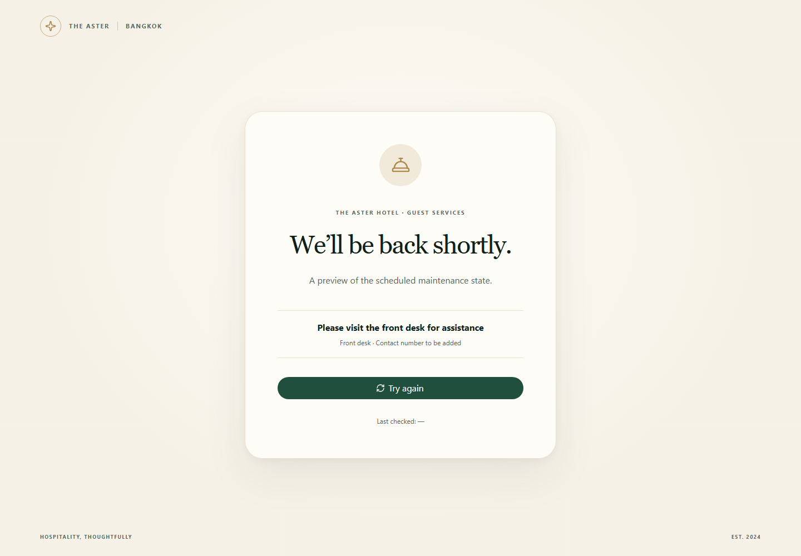
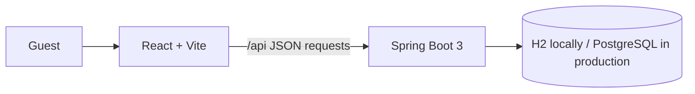

# The Aster Hotel | Self Check-In Kiosk

[](https://github.com/AivaN-Bash/Hotel_Checkin/actions/workflows/ci.yml)

A bilingual, touch-friendly self-service kiosk for **The Aster Hotel**. Guests can check in, receive a demo room and QR key, or check out an active stay. The interface uses a calm hotel-inspired visual design with clear, large-format guest flows.

**Live demo:** [Open the kiosk](https://frontend-nine-kohl-nzqk24mi4s.vercel.app)

> This is demonstration software only. Identity verification, deposits, and QR keys are simulated. Use only the included demo records.

## Features

- English and Thai kiosk copy
- Light and dark hotel themes
- Booking lookup by code or guest name and phone
- Check-in flow with identity and deposit demos
- Check-out flow for active stays
- Transactional room assignment and release
- 60-second inactivity reset and 12-second success reset
- Public service status and maintenance mode
- H2 local database and PostgreSQL production database
- Component preview at `/dev/components`

## Screenshots

### Welcome and check-in


### Maintenance screen



## Architecture



In production, Vercel rewrites `/api/*` to the Render-hosted Spring Boot service. Supabase provides the PostgreSQL database.

| Area | Technology |
| --- | --- |
| Frontend | React 19, TypeScript, Vite, HeroUI, Tailwind CSS |
| Backend | Java 17, Spring Boot 3, Spring Web, Validation, Spring Data JPA |
| Database | H2 for development, PostgreSQL for production |
| Migrations | Flyway |
| API documentation | Springdoc OpenAPI / Swagger UI |
| Tests | Vitest, Testing Library, JUnit, MockMvc |
| Deployment | Vercel, Render, Supabase |

## Demo data

| Booking code | Starting status | Use |
| --- | --- | --- |
| `DEMO2026` | Confirmed | Check-in |
| `DEMO2027` | Confirmed | Check-in |
| `DEMO2028` | Checked in | Check-out |

After the demo check-in or check-out is completed, the backend restores the seeded demo booking when that demo code is looked up again. This reset behavior applies only to `DEMO2026`, `DEMO2027`, and `DEMO2028`.

Restarting the H2 backend recreates the local demo state. Restarting a hosted PostgreSQL backend does not restore or reset hosted data.

## Local setup

Requirements:

- Java 17+
- Maven 3.9+
- Node.js 22+

Start the backend:

```sh
cd backend
mvn spring-boot:run
```

The API starts at `http://localhost:8080`.

In a second terminal, start the frontend:

```sh
cd frontend
npm ci
npm run dev
```

Open the Vite URL, normally `http://localhost:5173`. The Vite development server proxies `/api` to `http://localhost:8080`.

Configuration examples:

- [backend/.env.example](backend/.env.example)
- [frontend/.env.example](frontend/.env.example)

## Kiosk flow

### Check-in

1. Choose **Begin check-in**.
2. Find the booking by code or guest details.
3. Review the stay.
4. Complete the simulated identity step.
5. Complete the simulated deposit step.
6. View the assigned room and demo QR key.

### Check-out

1. Choose **Begin check-out**.
2. Find an active checked-in booking.
3. Review and confirm the stay.
4. Complete checkout and release the room.

Use `/dev/components` with the frontend running locally to preview the shared components and maintenance screen.

## API

The API is under `/api/v1`. Swagger UI is available at `/swagger-ui` while the backend is running.

| Method | Endpoint | Purpose |
| --- | --- | --- |
| `POST` | `/bookings/lookup` | Find a booking |
| `POST` | `/bookings/checkout-lookup` | Find an active check-out booking |
| `POST` | `/checkins` | Assign a room and complete check-in |
| `POST` | `/checkouts` | Complete checkout and release the room |
| `GET` | `/checkins/{id}` | Read a completed check-in |
| `GET` | `/rooms` | List rooms; requires the admin key |
| `GET` | `/status` | Read API, database, and maintenance status |
| `GET` | `/health` | Lightweight liveness check |
| `POST` | `/admin/maintenance` | Enable or disable maintenance mode |

See [docs/api.md](docs/api.md) for request and response examples. API errors use:

```json
{
  "timestamp": "2026-11-25T09:00:00Z",
  "status": 400,
  "code": "VALIDATION_ERROR",
  "message": "Request validation failed."
}
```

## Maintenance mode

Set `ADMIN_API_KEY` to a secret of at least 32 characters. Set `MAINTENANCE_MODE=true` to start in maintenance mode, or toggle it at runtime:

```sh
curl -X POST "$API_URL/api/v1/admin/maintenance" \
  -H "Content-Type: application/json" \
  -H "X-Admin-Key: $ADMIN_API_KEY" \
  -d '{"enabled":true,"message":"We are preparing your room.","estimatedBackAt":"2030-01-01T12:00:00Z"}'
```

Disable maintenance by repeating the request with `"enabled":false`.

The maintenance state is held in memory. Database failures and maintenance changes do not expose internal database details.

## Production configuration

The backend production profile expects:

| Variable | Purpose |
| --- | --- |
| `SPRING_PROFILES_ACTIVE` | Set to `prod` |
| `DATABASE_URL` | JDBC PostgreSQL URL |
| `DATABASE_USERNAME` | PostgreSQL username |
| `DATABASE_PASSWORD` | PostgreSQL password |
| `ADMIN_API_KEY` | Secret of at least 32 characters |
| `MAINTENANCE_MODE` | Optional initial maintenance state |
| `CORS_ALLOWED_ORIGINS` | Optional comma-separated exact origins |

The frontend uses `VITE_API_URL=/api` for the Vercel rewrite. Deploy configuration is in [frontend/vercel.json](frontend/vercel.json), and the container definition is in [backend/Dockerfile](backend/Dockerfile).

Never commit database passwords or admin keys.

## Tests and quality checks

Frontend:

```sh
cd frontend
npm ci
npm test
npm run lint
npm run format:check
npm run build
```

Backend:

```sh
cd backend
mvn verify
```

GitHub Actions runs the frontend checks and backend Maven verification for pushes and pull requests to `main`.

## Project structure

| Path | Responsibility |
| --- | --- |
| `frontend/src/App.tsx` | Application state and screen routing |
| `frontend/src/hooks/` | Kiosk flow, idle timer, and service status |
| `frontend/src/pages/FlowScreens.tsx` | Guest journey screens |
| `frontend/src/components/` | Shared kiosk UI components |
| `frontend/src/i18n/` | English and Thai copy |
| `backend/src/main/java/com/hotelcheckin/api/` | REST controllers and DTOs |
| `backend/src/main/java/com/hotelcheckin/service/` | Booking and maintenance rules |
| `backend/src/main/java/com/hotelcheckin/repository/` | Database access |
| `backend/src/main/resources/db/migration/` | Flyway schema and demo data |

Further details are available in [docs/architecture.md](docs/architecture.md) and [docs/api.md](docs/api.md).

## Limits

- This demo does not perform real identity verification or payment.
- The demo QR key is not a door lock credential.
- There is no production guest authentication or property-management integration.
- The browser flow is not a hotel property-management system.
- Production readiness would require rate limiting, auditing, monitoring, backups, alerting, and stronger secret management.
