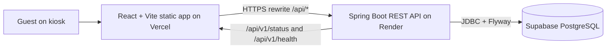
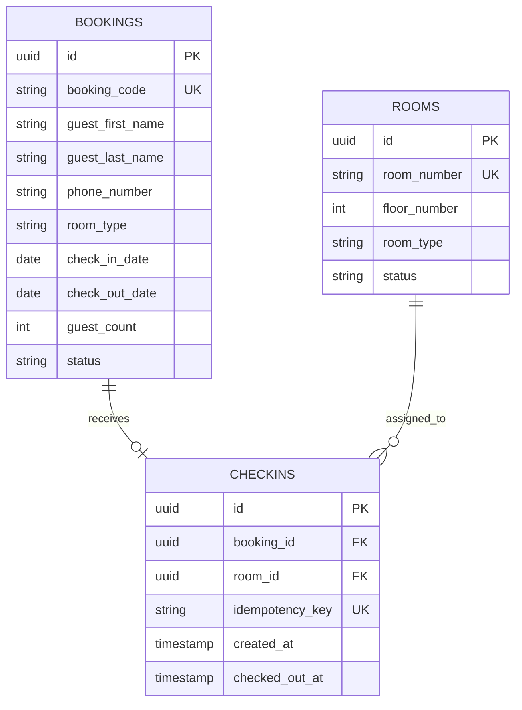

# Architecture

The browser owns the temporary kiosk flow and keeps no booking data in persistent browser storage. The API validates requests and returns DTOs. PostgreSQL is authoritative for booking and room state. A check-in transaction locks the booking and selects a compatible room with `FOR UPDATE SKIP LOCKED`, so concurrent check-ins cannot assign the same room. An idempotency key makes check-in retries return the original result. Checkout locks the booking, records `checked_out_at`, marks the booking `CHECKED_OUT`, and makes its room available in the same transaction.

The runtime maintenance switch lives in memory so it remains usable while PostgreSQL is unavailable. The status endpoint has a short database connection timeout. The frontend polls it, distinguishes a cold start from a sustained outage, and preserves the guest's current step for up to five minutes.

## Data model

Flyway owns schema creation and the fake demo seed. Hibernate validates the schema at startup and does not mutate it.
